# Ash n Seed

Belediye başkanı olarak otuz günde Karatepe'yi yeniden yeşertmeye çalıştığın, 2 boyutlu piksel sanatlı bir şehir yönetimi oyunu. COP31 Oyun Hackathonu için yapıldı.

> ⚠️ **Oyunu en yüksek performansta oynamak için Windows sürümünü indirin.** Web sürümü tarayıcı sınırları yüzünden daha düşük performansla çalışır.

---

## ⬇️ Windows sürümünü indir

**[Windows sürümünü indir (Google Drive)](https://drive.google.com/file/d/1p2ocon1u19Ob4lkMtPF5Kua7s97OacQD/view)**

İndirdiğin dosya zip ise bir klasöre çıkar, sonra `AshNSeed.exe`'yi çalıştır. Kurulum gerekmez.

Windows "bilinmeyen yayıncı" uyarısı verirse **Daha fazla bilgi** > **Yine de çalıştır** de. Oyun imzalı olmadığı için bu uyarı normal.

Oyunun sayfası ve web sürümü: **[beyuphan.itch.io/ashnseed](https://beyuphan.itch.io/ashnseed)**

> Bu repo oyunun kaynak kodudur. Sadece oynamak istiyorsan yukarıdaki indirme bağlantısı yeterli.

## 🎬 Tanıtım videosu

- Türkçe: *link eklenecek*
- English: *link eklenecek*

---

## Ekran görüntüleri

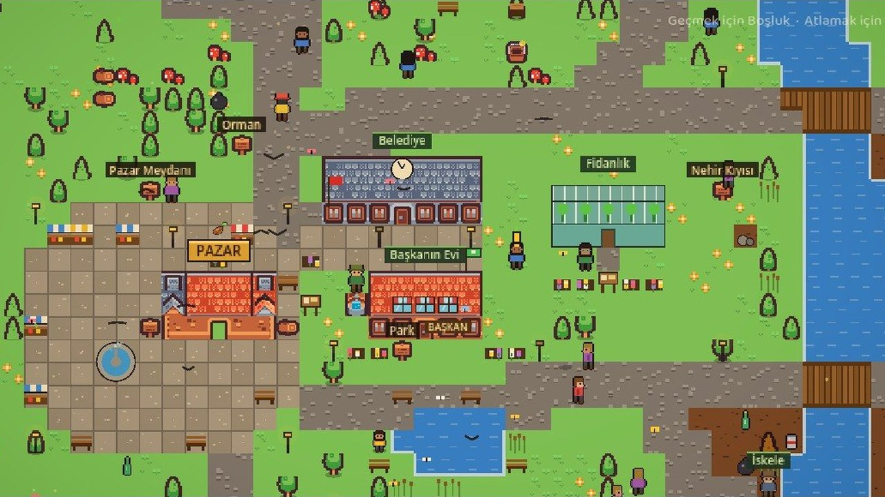

| | |
|---|---|
| 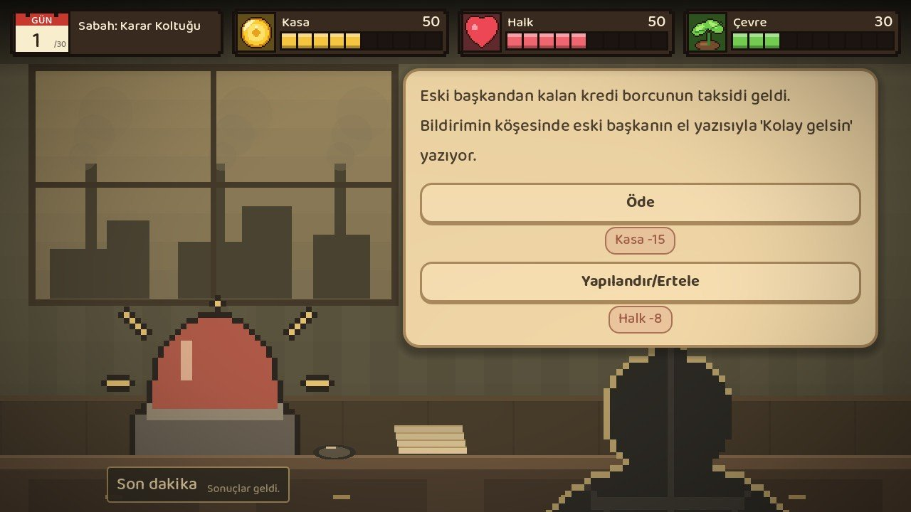 | 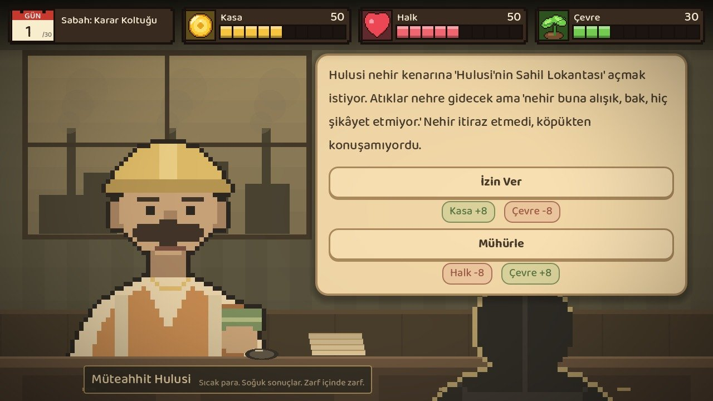 |
| **Masa:** Karar kartları | **Müteahhit Hulusi** her zaman bir teklifle gelir |
| 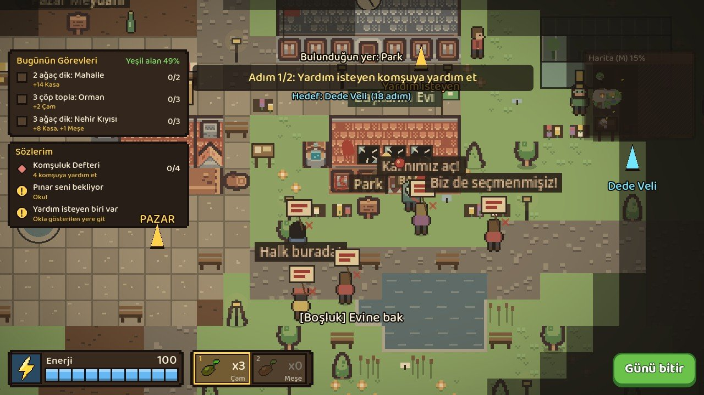 | 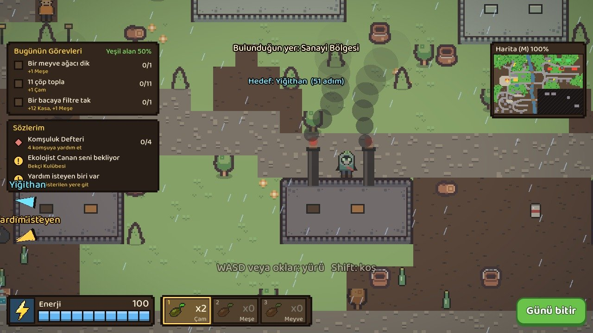 |
| **Saha:** Görevler ve komşular | Fabrika bacalarına filtre tak |
| 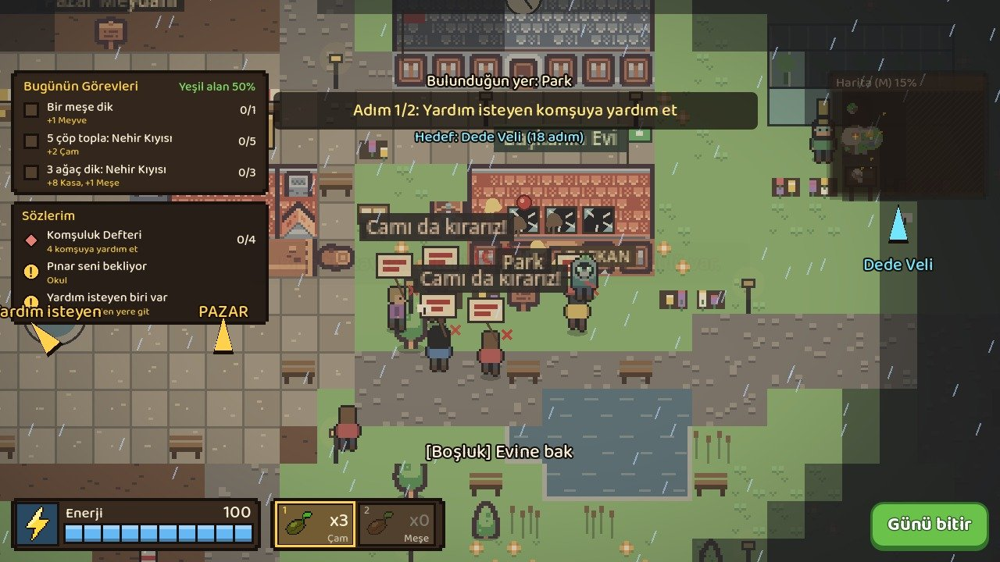 | 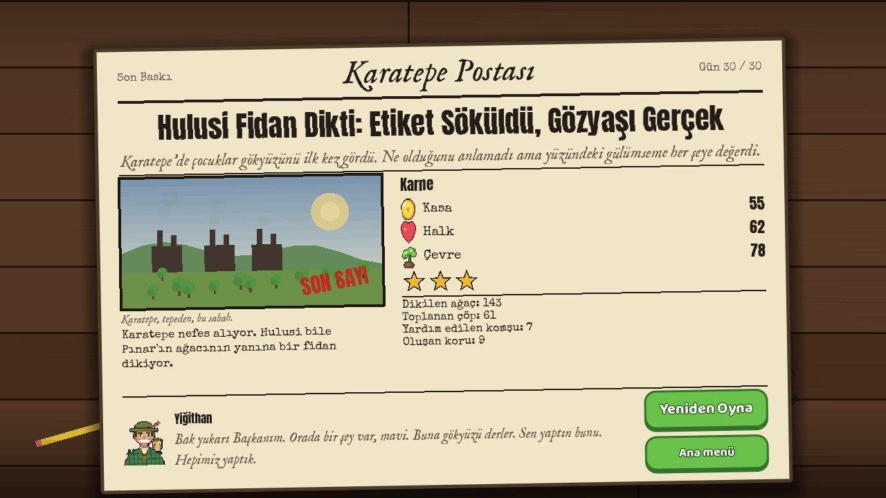 |
| Halk Başkan'ın evinin önünde toplandı | **Gazete:** Karatepe Postası |

### Mini oyunlar

| | |
|---|---|
| 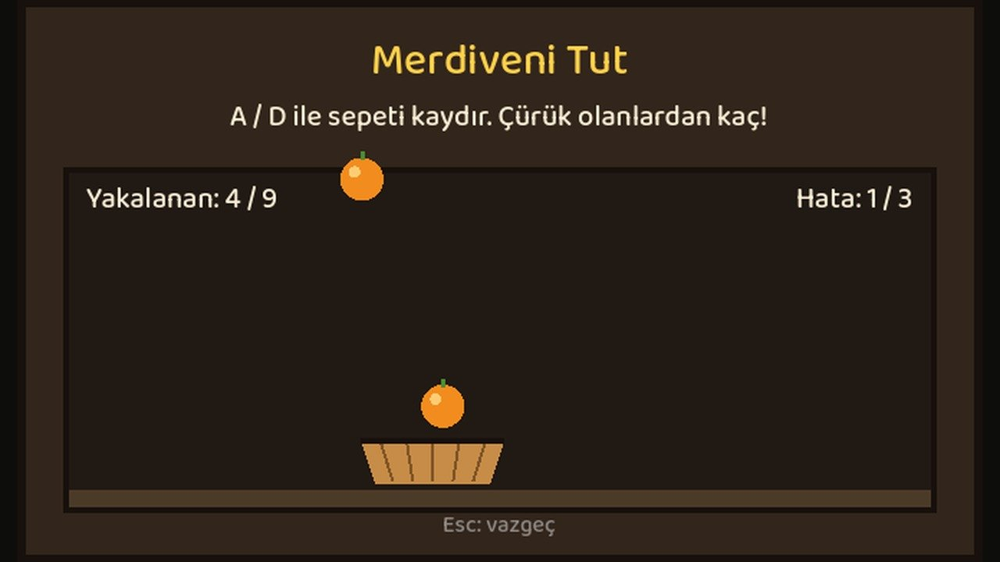 | 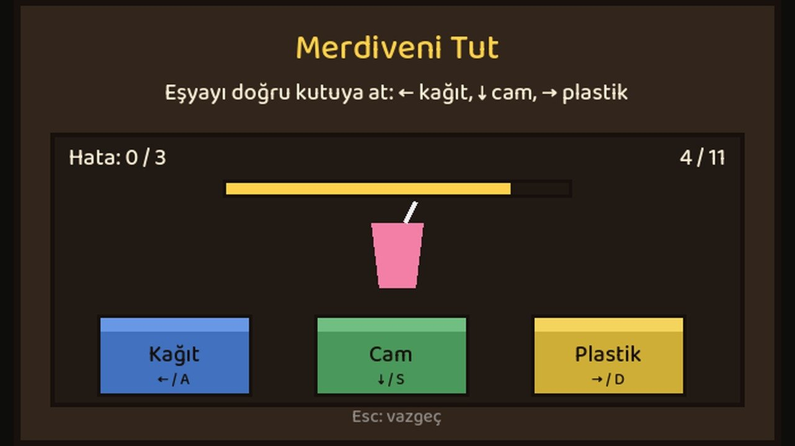 |
| Portakal yakala | Geri dönüşümü ayıkla |
| 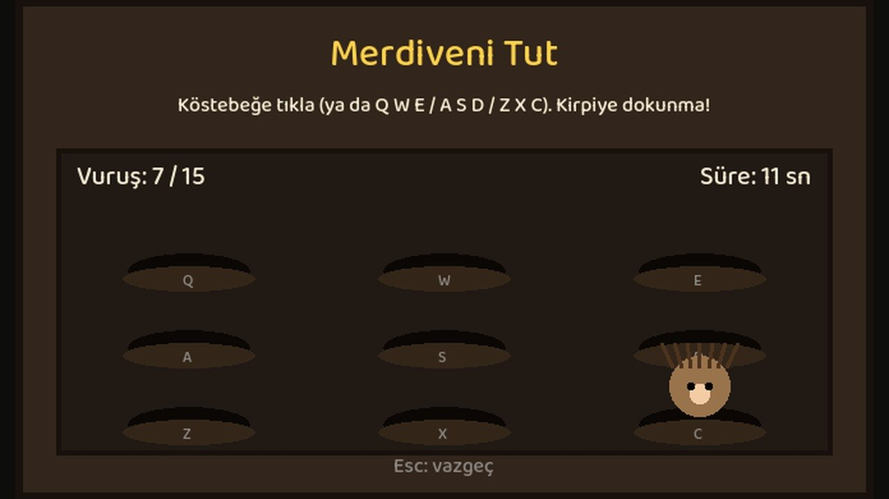 | 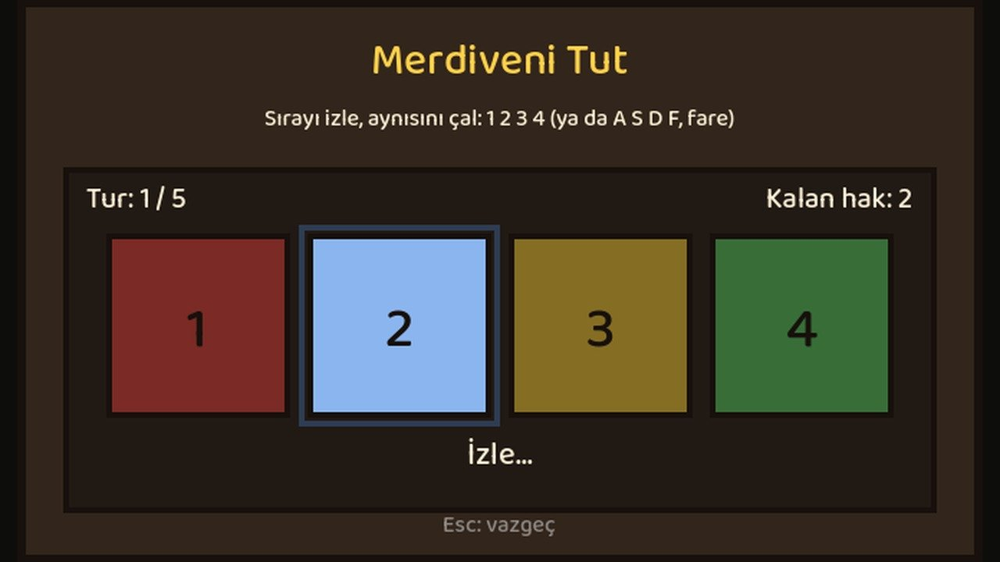 |
| Köstebeği kov (kirpiye dokunma) | Sırayı hatırla |

---

## Hikaye

Karatepe, fabrika dumanı yüzünden nefes alınamayan küçük bir kasaba. Kimse belediye başkanı olmak istemeyince koltuk sana kaldı. Elinde bir avuç tohum ve otuz gün var.

Sabah masada kararlar veriyor, gün içinde sahada ağaç dikip çöp topluyorsun. Amacın, kasa boşalmadan ve halk sana küsmeden Karatepe'yi yeniden yeşertmek.

## Nasıl oynanır?

Her gün üç parçadan oluşur:

1. **Masa:** Karar kartları gelir. Her seçim Kasa, Halk ve Çevre dengesini oynatır.
2. **Saha:** Haritada gezip ağaç dikersin, çöp toplarsın, fabrikaların bacalarına filtre taktırırsın ve komşuların yardım isteklerini mini oyunlarla çözersin.
3. **Gazete:** Akşam Karatepe Postası masana fırlar. Kararlarının sonucu manşette, çoğu zaman komik.

**Kelebek etkisi:** Bugün verdiğin karar, günler sonra karşına çıkar. Kömür dağıtırsan astım salgını, çöpü ormana yığarsan zehirli su seni bulur.

### Kontroller

| Tuş | İş |
|---|---|
| WASD / Ok tuşları | Yürü |
| Shift | Koş |
| Boşluk | Ağaç dik, konuş, etkileşime gir |
| 1, 2, 3 / Tab | Tohum türünü seç |
| R | Topladığın çöpü geri dönüştür |
| E | Çay al |
| U | Dükkân |
| J | Günlük |
| H | Rehberin son ipucunu tekrar göster |
| M | Büyük harita |
| Esc | Duraklat |
| F11 / Alt+Enter | Tam ekran |

Karar kartlarında fare ile seçim yapabilirsin. Mini oyunlarda tuşlar oyunun kendi ekranında yazar.

## Neler var?

- 30 günlük, 6 bölümlük bir hikaye
- 135 karar kartı
- 12 karakter: Tomurcuk, Hulusi, Canan, Nezaket Teyze, Rıza, Veli Dede, Mırmır, Yiğithan ve daha fazlası
- 9 mini oyun: portakal yakalama, geri dönüşüm ayıklama, köstebek kovalama, hafıza oyunu, kasa kulesi ve daha fazlası
- Sel, fırtına, yangın ve kuraklık gibi felaketler
- Türkçe ve İngilizce
- Oyunun kendi müzikleri ve ses efektleri

## COP31 temaları

**Ana tema:** İklim Dirençli Şehirler

**Yan temalar:** Sıfır Atık, İklim Değişikliği Odağında Eğitim, Gıda Güvenliği

## Kaynak koddan çalıştırma

1. [Godot 4.7](https://godotengine.org/download) indir.
2. Bu repoyu klonla ve Godot'ta `project.godot` dosyasını aç.
3. İlk açılışta Godot kaynakları içe aktarır, sonra `F5` ile çalıştır.

Karar kartları ve metinler `tools/` klasöründeki Python betikleriyle üretiliyor. İçeriği değiştirirsen sırasıyla şunları çalıştır:

```
python tools/build_story.py
python tools/apply_content.py
godot --headless --path . --import
```

### Klasörler

| Klasör | İçeriği |
|---|---|
| `scripts/` | Oyun kodu (GDScript) |
| `scenes/` | Sahneler |
| `data/`, `translations/` | Kart verisi ve Türkçe/İngilizce metinler |
| `tools/` | İçerik ve müzik üreten Python betikleri |
| `assets/` | Çizimler, yazı tipleri, sesler |

## Yapımcı

**Eyüphan Binici**

## Lisanslar

Üçüncü taraf içeriklerin kaynakları ve lisansları için [CREDITS.md](CREDITS.md) dosyasına bak.
